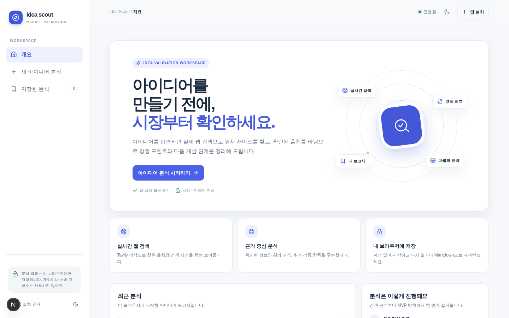
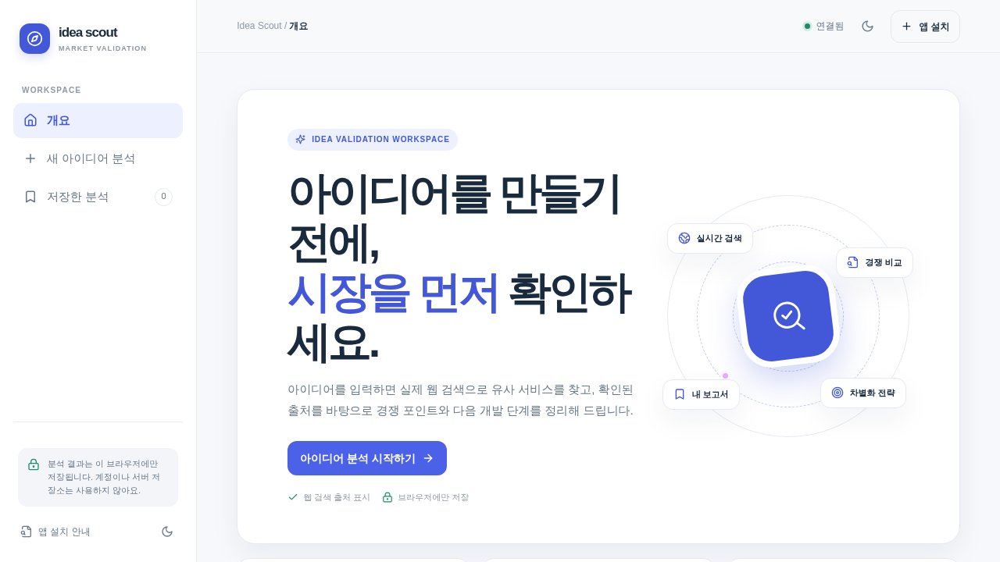
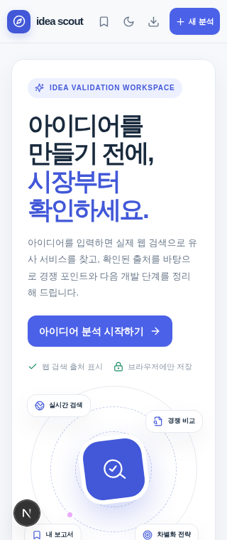
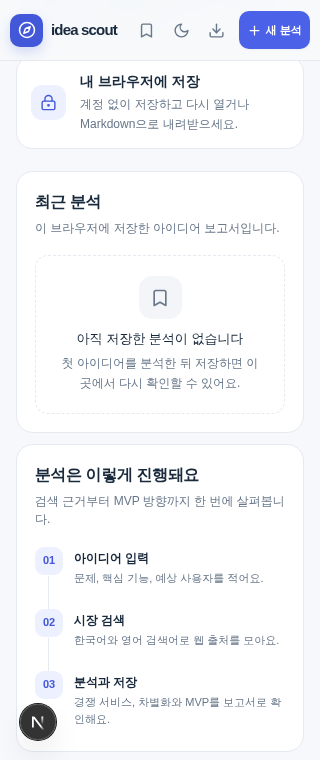
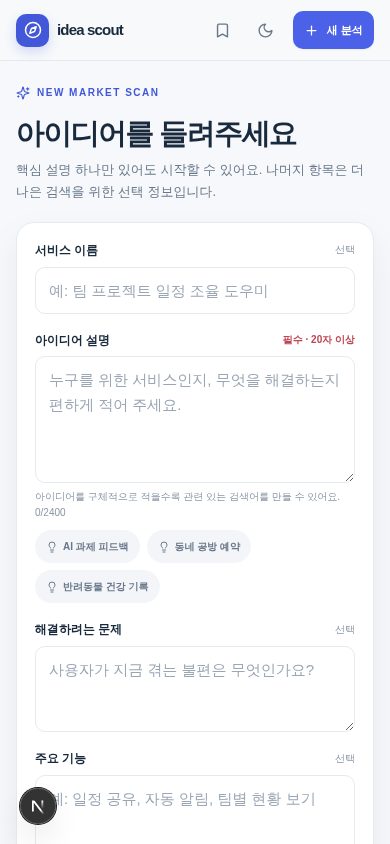
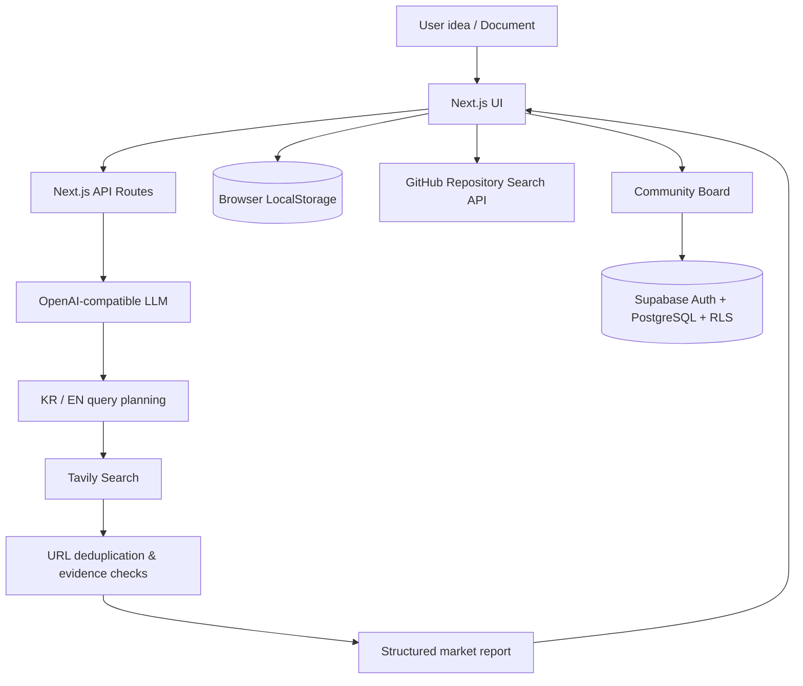

<div align="center">
  

  # Idea Scout

  **From an idea to evidence-backed market exploration.**

  아이디어를 입력하면, 공개 웹 검색 근거를 바탕으로 경쟁 서비스와 차별화 방향을 탐색하는 **AI 아이디어 리서치 워크스페이스**

  <p>
    <a href="https://github.com/Byun-Gwan-Young/IS/stargazers"></a>
    <a href="https://github.com/Byun-Gwan-Young/IS/issues"></a>
    
  </p>

  <p>
    
    
    
    
    
  </p>

  [**Features**](#-features) · [**Screenshots**](#-screenshots) · [**Getting Started**](#-getting-started) · [**Architecture**](#-architecture) · [**Roadmap**](#-roadmap)
</div>

---

## ✦ Overview

> **좋은 아이디어는 직감에서 시작할 수 있지만, 다음 결정에는 근거가 필요합니다.**

새로운 서비스를 기획할 때 경쟁사를 일일이 검색하고, 흩어진 정보를 비교하고, 차별화할 지점을 정리하는 데 많은 시간이 듭니다. **Idea Scout**는 이 초기 탐색 과정을 하나의 흐름으로 연결합니다.

**아이디어 입력 → AI 검색어 설계 → 실시간 웹 검색 → 근거 기반 분석 → 결과 저장 및 공유용 내보내기**

검색 결과로 확인된 **근거(Evidence)**, 모델의 **해석(Interpretation)**, 아직 검증해야 할 **질문(Validation questions)**을 구분하여 보여주는 것이 핵심입니다.

> [!IMPORTANT]
> Idea Scout는 **시장 탐색을 돕는 MVP**입니다. 검색 결과만으로 실제 시장 규모, 수요, 사업 성공 가능성을 확정하지 않습니다. 중요한 판단은 원문 확인과 잠재 사용자 인터뷰를 병행해 주세요.

## ✨ Features

| | 기능 | 설명 |
|:--:|---|---|
| 🔎 | **AI Market Research** | 한국어·영어 검색어를 계획하고 Tavily의 실시간 검색 결과를 바탕으로 시장 신호와 경쟁 서비스를 분석합니다. |
| 🧭 | **Evidence-first Reports** | 아이디어 요약, 경쟁 서비스, 차별화 포인트, MVP 제안, 출처를 구조화하고 근거와 AI 해석을 구분합니다. |
| 📄 | **Document to Idea** | PDF, DOCX, TXT, MD 파일에서 내용을 추출해 아이디어 입력을 보조합니다. |
| 🐙 | **GitHub Explorer** | GitHub Repository Search API로 오픈소스를 탐색하고 선택한 저장소를 바탕으로 AI 서비스 아이디어 3개를 제안합니다. |
| 💬 | **Community Board** | 아이디어 게시, 공개·비공개 설정, 카테고리·검색·정렬, 투표 및 AI 문장 정리 기능을 제공합니다. |
| 💾 | **Save & Export** | 분석 보고서를 브라우저에 저장·재열람·삭제하고 Markdown으로 내려받을 수 있습니다. |
| 📱 | **Responsive PWA** | 모바일 대응 UI, 다크 모드, 설치 프롬프트, 제한적인 오프라인 앱 셸 캐시를 지원합니다. |

<details>
<summary><b>기능별 동작 방식 자세히 보기</b></summary>
<br />

- **근거 검증:** URL 중복을 정리하고, 경쟁사 후보의 출처 ID와 링크가 실제 수집된 검색 결과에 존재하는지 확인합니다. 모든 생성 문장의 참·거짓을 독립적으로 보증하는 것은 아닙니다.
- **문서 처리:** 최대 10MB 업로드, PDF 최대 100페이지 및 추출 텍스트 최대 24,000자 제한을 적용합니다. 업로드된 파일 자체는 서버 디스크·DB에 저장하지 않습니다. 이미지 기반 스캔 PDF는 OCR을 지원하지 않습니다.
- **GitHub 탐색:** 언어, 카테고리, 스타 수, 생성·업데이트 조건을 활용합니다. 공식 GitHub Trending 데이터가 아니라 Repository Search API 결과입니다.
- **커뮤니티:** Supabase가 설정되면 익명 인증과 RLS를 사용하여 공유 게시글·투표를 관리합니다. 미설정 시 **브라우저 로컬 데모 모드**로 동작합니다.
- **보고서 저장:** LocalStorage 기반이므로 브라우저·기기를 변경하면 보고서가 동기화되지 않습니다.

</details>

## 🖼 Screenshots

<div align="center">
  
  <p><sub>Desktop experience · 실제 저장소에 포함된 프로젝트 스크린샷</sub></p>
</div>

<details>
<summary><b>웹 홈 화면 및 모바일 화면 더 보기</b></summary>
<br />

<div align="center">
  
  <p><sub>Home screen</sub></p>
  
  
  
  <p><sub>Responsive mobile experience</sub></p>
</div>

</details>

## 🧰 Tech Stack

| 영역 | 사용 기술 |
|---|---|
| **Frontend** | Next.js 16 (App Router), React 19, TypeScript, Tailwind CSS |
| **Backend / API** | Next.js Route Handlers, Zod |
| **AI / Search** | OpenAI-compatible Chat Completions API, Tavily Search API |
| **Open Source Discovery** | GitHub REST API |
| **Community** | Supabase Auth (Anonymous), PostgreSQL, Row Level Security |
| **Documents** | `pdf-parse`, `mammoth`, `busboy` |
| **Client Storage / PWA** | LocalStorage, Web App Manifest, Service Worker |
| **Testing** | Node.js test runner via `tsx`, TypeScript type checking |

## 🚀 Getting Started

### 1. Clone & install

[Node.js](https://nodejs.org/)와 npm이 설치된 환경에서 실행합니다.

```bash
git clone https://github.com/Byun-Gwan-Young/IS.git
cd IS
npm install
```

### 2. Configure environment

```bash
cp .env.example .env.local
```

Windows PowerShell에서는 `Copy-Item .env.example .env.local`을 사용하세요.

`.env.local` 파일에 본인의 키를 입력합니다.

```dotenv
# Required for market analysis
TAVILY_API_KEY=your_tavily_api_key
LLM_API_KEY=your_llm_api_key

# OpenAI-compatible provider settings (defaults from .env.example)
LLM_BASE_URL=https://api.baze.co/v1/gateway
LLM_MODEL=gemini-3.8-flash

# Optional: shared community
NEXT_PUBLIC_SUPABASE_URL=
NEXT_PUBLIC_SUPABASE_ANON_KEY=

# Optional: improve GitHub Search API rate limit
GITHUB_TOKEN=
```

- **필수:** 분석 기능에는 Tavily API 키 및 선택한 LLM 제공업체의 API 키가 필요합니다.
- **LLM 제공업체:** `LLM_BASE_URL`은 OpenAI 호환 API 주소이며 `LLM_MODEL`은 해당 계정에서 실제 이용 가능한 모델로 지정해야 합니다.
- **Supabase:** 설정하지 않으면 커뮤니티는 다른 사용자와 공유되지 않는 로컬 데모 모드로 실행됩니다.
- **GitHub token:** 선택 사항입니다. 지정하지 않아도 공개 저장소 검색은 가능하지만 인증되지 않은 API 호출 제한이 적용됩니다.

> [!CAUTION]
> 실제 API 키를 GitHub에 커밋하지 마세요. `LLM_API_KEY`, `TAVILY_API_KEY`, `GITHUB_TOKEN` 등 비밀 키에 `NEXT_PUBLIC_` 접두사를 붙이면 안 됩니다. Supabase anon 키는 공개 설정값이지만, 공유 커뮤니티를 운영한다면 **RLS 설정이 필수**입니다.

### 3. Run the development server

```bash
npm run dev
```

브라우저에서 **http://localhost:3000** 에 접속하세요.

### 4. Optional — shared community setup

1. Supabase 프로젝트를 만들고 `.env.local`에 `NEXT_PUBLIC_SUPABASE_URL`, `NEXT_PUBLIC_SUPABASE_ANON_KEY`를 입력합니다.
2. Supabase Authentication 설정에서 **Anonymous Sign-Ins**를 활성화합니다.
3. Supabase SQL Editor에서 [`supabase/schema.sql`](./supabase/schema.sql)을 실행합니다.
4. 개발 서버를 재시작합니다.

> [!NOTE]
> 익명 세션 정보가 삭제되면 기존 비공개 게시글에 접근하지 못할 수 있습니다. 인증이나 스키마 설정에 오류가 있는 경우, 공유 모드가 자동으로 정상 동작한다고 가정하지 마세요.

### 5. Check & build

```bash
npm test
npm run typecheck
npm run build
npm run start
```

`npm run build`는 배포용 빌드, `npm run start`는 빌드된 앱 실행에 사용합니다. 개발 중에는 `npm run dev`만으로 시작할 수 있습니다.

## 🏗 Architecture



**분석 파이프라인의 중요한 원칙**

1. 사용자의 아이디어를 검증하고 LLM이 한국어·영어 검색어를 생성합니다.
2. Tavily에서 공개 웹 검색 결과를 수집한 뒤 URL 정규화·중복 제거를 수행합니다.
3. 수집된 출처를 기반으로 구조화된 리포트를 생성하고 Zod로 결과를 검사합니다.
4. 확인되지 않은 경쟁 서비스 출처 ID 및 검색 결과에 없는 웹사이트 URL은 결과에서 제외합니다.
5. 분석 진행 상태와 최종 보고서를 UI에 전달합니다. 검색 실패 시 가상의 경쟁사 목록을 대신 제공하지 않습니다.

<details>
<summary><b>Repository structure</b></summary>

```text
IS/
├── app/
│   ├── api/
│   │   ├── analyze/           # Idea analysis API
│   │   ├── documents/extract/ # Document extraction
│   │   ├── github/            # Repository discovery & idea generation
│   │   └── community/normalize/
│   ├── globals.css
│   └── layout.tsx
├── components/
│   ├── views/                 # Main application views
│   ├── ui/                    # Reusable UI components
│   └── market-app.tsx
├── lib/
│   ├── server/                # LLM, search, document, GitHub logic
│   ├── supabase/              # Supabase browser client
│   ├── contracts.ts
│   └── community-utils.ts
├── supabase/
│   └── schema.sql             # Tables, permissions & RLS policies
├── public/
│   ├── icon.svg
│   ├── manifest.webmanifest
│   └── sw.js
├── tests/
├── .env.example
└── package.json
```

</details>

## 🔐 Security & Limitations

| 주제 | 현재 동작 / 주의사항 |
|---|---|
| **API credentials** | LLM·Tavily·GitHub 비밀 키는 서버 환경 변수에서 사용합니다. |
| **Evidence quality** | 경쟁 서비스 링크의 출처를 확인하지만 분석 문장 전체를 독립적으로 사실 검증하지는 않습니다. |
| **Document uploads** | 파일은 메모리에서 처리하며, 추출된 텍스트는 설정된 LLM 제공업체로 전송됩니다. |
| **Saved reports** | 브라우저 LocalStorage에만 저장되며 다른 기기와 동기화되지 않습니다. |
| **Community privacy** | Supabase RLS 설정을 전제로 공개 게시물과 작성자 비공개 게시물을 구분합니다. |
| **Rate limiting** | 분석 요청 제한은 프로세스 단위의 MVP 구현으로, 분산 환경 공통 제한이 아닙니다. |
| **Offline support** | 앱 셸·정적 자원 캐시 중심이며 새로운 AI 분석 및 API 요청은 오프라인에서 동작하지 않습니다. |

## 🗺 Roadmap

현재 구현된 기능과 앞으로의 개선 계획을 구분합니다.

- [x] AI 기반 시장 탐색 및 근거 연결 보고서
- [x] PDF / DOCX / TXT / MD 파일 입력
- [x] GitHub 오픈소스 탐색 및 아이디어 제안
- [x] Supabase 연동 커뮤니티 및 로컬 데모 모드
- [x] 반응형 UI, 다크 모드, 기본 PWA 지원
- [ ] 개별 주장과 출처 간의 독립적인 검증 및 검색 재순위화
- [ ] OpenAlex / Semantic Scholar 검색 어댑터
- [ ] 스캔 문서 OCR 지원
- [ ] 사용자 인터뷰 및 수요 검증 근거 기록
- [ ] 커뮤니티 신고·운영 도구 및 계정 복구
- [ ] 분산 요청 제한 및 API 사용량 모니터링
- [ ] PWA 아이콘 보완 및 자동화된 운영 환경 점검

## 🤝 Contributing

버그 신고, 기능 제안, 개선 논의는 [Issues](https://github.com/Byun-Gwan-Young/IS/issues)에서 진행할 수 있습니다.

1. 관련 이슈를 확인하거나 새 이슈를 작성합니다.
2. 변경 사항을 별도 브랜치에서 구현합니다.
3. `npm test`, `npm run typecheck`, `npm run build`로 검증합니다.
4. 변경 이유와 테스트 결과를 포함해 Pull Request를 생성합니다.

**License:** 현재 저장소에 별도의 `LICENSE` 파일이 확인되지 않습니다. 공개 저장소라고 해서 코드의 재사용·재배포가 자동으로 허용되는 것은 아닙니다. 이용 조건이 필요한 경우 저장소 소유자에게 문의해 주세요.

---

<div align="center">
  <b>Idea Scout</b><br />
  <sub>Explore ideas. Find evidence. Build with intention.</sub><br /><br />
  <a href="https://github.com/Byun-Gwan-Young/IS">Repository</a> · <a href="https://github.com/Byun-Gwan-Young/IS/issues">Report an issue</a> · <a href="https://github.com/Byun-Gwan-Young/IS/stargazers">Star this project ⭐</a>
</div>
